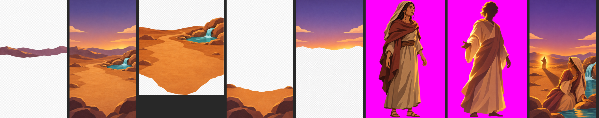
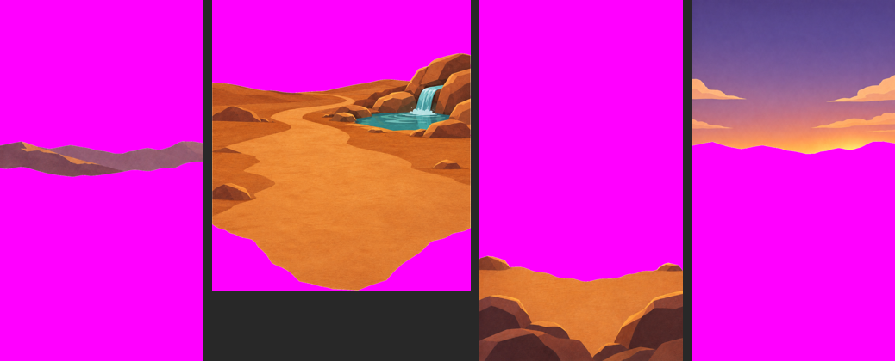

# SPIKE-001 — Resultado: técnicas 2D para escenarios por capas

**Spike:** [`SPIKE-001-tecnicas-de-animacion-2d.md`](SPIKE-001-tecnicas-de-animacion-2d.md)  
**Fecha:** 2026-11-11  
**Estado:** investigación completada; pendiente de revisión del usuario  
**Alcance respetado:** no se rehízo ni generó arte, no se modificó código ni la duración/guion del episodio 01. Las pruebas de limpieza se hicieron sobre copias temporales; `public/assets/` no cambió.

---

## 0. Resumen ejecutivo

1. **La técnica base es una cámara virtual multiplano**: una sola “cámara” (x, y, zoom) que mueve cada capa según un factor de profundidad. Con ella se resuelven gancho, viaje, llegada, revelación y cierre sin animar cuadro a cuadro.
2. **Los personajes se animan con animación limitada**: pose sostenida + respiración + balanceo. Un gesto articulado se añade solo si se prepara la pieza necesaria. Agar y el mensajero ya tienen alfa real y sirven para el animatic como figuras completas.
3. **Las capas actuales de Shur no permiten un recorrido amplio**: tres miden 941 × 1672 y la de camino/fuente 1180 × 1333; tienen tablero opaco y no comparten un lienzo alineado ni solapes suficientes. Sirven como referencia y para pruebas de composición muy controladas. Para recorridos finales conviene preparar arte nuevo, más grande, con alfa real y solape.
4. **Cálculo del lienzo de arte** (sección 3): medir los extremos del encuadre para cada capa durante todo el movimiento; la fórmula abreviada es una cota conservadora, no el mínimo exacto.
5. **Conjunto reducido para el episodio 01**: cámara multiplano, push-in/pull-out lento, paneo lateral con parallax, respiración/balanceo, sombra proyectada + contraluz, polvo/calima y fundidos. Nada más hasta validar el animatic.

---

## 1. Auditoría de recursos actuales

Análisis automático de dimensiones, canal alfa y píxeles neutros claros (patrón de tablero), más revisión visual.



*De izquierda a derecha: montañas, escena completa de referencia, camino y fuente, primer plano rocoso, cielo (las cinco de Shur), Agar y mensajero compuestos sobre magenta para mostrar su alfa real, y la escena guía de Agar en la fuente.*

| Recurso | Tamaño | Alfa | Hallazgo | Uso recomendado |
|---|---|---|---|---|
| `shur-spring-violet-dawn-sky.png` | 941 × 1672 | No (RGB) | Tablero opaco del 59 % del lienzo. El cielo termina en el horizonte (y≈655–711) y debajo no hay nada. | Capa de animatic tras limpieza. Para final: regenerar opaco hasta el borde inferior. |
| `shur-spring-distant-mountains.png` | 941 × 1672 | No | Tablero del 93 %. Franja de montaña entre y≈655 y y≈818; su borde superior coincide exactamente con el borde inferior del cielo. | Capa de animatic tras limpieza; sin solape, abre costuras con parallax vertical. |
| `shur-spring-path-and-spring.png` | 1180 × 1333 | No | Tablero del 38 %. Lienzo con proporción distinta a las demás; necesita posición y escala propias. | Plano medio de animatic tras limpieza. |
| `shur-spring-rocky-foreground.png` | 941 × 1672 | No | Tablero del 75 %. Rocas desde y≈1190 hasta el borde inferior. | Primer plano de animatic tras limpieza. |
| `shur-spring-full-scene-reference.png` | 941 × 1672 | No | Composición plana completa. | Solo referencia de encuadre y luz; no es una capa. |
| `agar-weary-traveler-full-body.png` | 1024 × 1536 | **Sí, real** | Figura aislada, borde suave. El interior tiene alfa 253 (casi opaco, no 255). | **Capa utilizable ya** para pose sostenida. El 253 interior no impide el animatic; revisar visualmente antes de retocarlo. |
| `angel-warm-backlit-silhouette.png` | 1024 × 1536 | **Sí, real** | Figura aislada con brazo extendido; mismo alfa 253 interior. `ARTS-NEEDED.md` lo describe erróneamente como compuesto. | **Capa utilizable ya**; la sombra/contraluz finales requieren ajustar dirección y apoyo al suelo. |
| `agar-closeup-warm-desert-light.png` | 1024 × 1536 | No | Primer plano compuesto con fondo. | Plano de reacción a pantalla completa (con push-in), no como capa. |
| `hagar-at-desert-spring.png` | 941 × 1672 | No | Escena compuesta. | Referencia de composición para el encuentro. |
| Logo `ismael-logo-wordmark.png` | 1080 × 1080 | No | Fondo blanco. | Placa de cierre clara, o usar `ismael-symbol*.png` (alfa real) sobre fondo propio. |

### 1.1 Capas con cuadrícula opaca: ¿limpiar o regenerar?

Se probó una limpieza automática sobre copias en memoria: los píxeles casi neutros y claros (diferencia entre canales < 10, valor > 200) se marcan como fondo. El tablero tiene cuadros de 11–13 px y tonos 238–254.



**Resultado:** la limpieza funciona porque el estilo es plano y terroso, sin blancos en el arte (el cielo no pierde nubes). Pero tiene tres límites que la limpieza no corrige:

1. **Bordes duros**: el recorte es binario, sin antialias. Hace falta erosionar 1 px y suavizar el alfa 1–2 px para que no aparezca un halo claro.
2. **Cero solape**: cada capa termina donde empieza la siguiente. Con parallax, la diferencia de desplazamiento abre huecos (por ejemplo, entre cielo y montañas).
3. **Tamaño insuficiente**: 941 × 1672 obliga a escalar ×1,148 solo para cubrir la ventana, sin margen para paneos. Con un push-in a 1,2 la ampliación llega a ×1,38 y el arte se ablanda.

**Decisión propuesta:**
- **Animatic:** usar el fondo compuesto como guía estática y, si se necesitan capas, limpiar *copias* de las cuatro imágenes. Extender detrás de cada recorte con pintura coherente y alinear manualmente la capa de camino/fuente. Una extensión de color plano solo sirve para comprobar geometría: puede verse como una costura en cámara.
- **Final:** solicitar un set de Shur con alfa real, escala/registro compartidos, cobertura y solape calculados para los planos aprobados. La comparación entre regenerar y repintar queda abierta hasta ver un nuevo arte de muestra; la limpieza automática no recupera información faltante.

---

## 2. Catálogo de técnicas

Esfuerzo: **B** bajo (solo código/cámara), **M** medio (requiere preparar alguna capa), **A** alto (requiere piezas nuevas o rig).

### 2.1 Cámara y escenario

| Técnica | Qué es | Esfuerzo | Límites | Cuándo usarla |
|---|---|---|---|---|
| **Cámara multiplano / parallax** | Cada capa se desplaza `p × movimiento de cámara`, con `p` según su profundidad. | B (con capas listas) | Requiere solape entre capas; con factores muy distintos el efecto “teatro de cartón” se vuelve evidente. | Base de todas las escenas. |
| **Push-in / pull-out** (zoom lento) | Escala 1,00→1,15 en 3–6 s, con la escala por capa `1+(z−1)·p`. | B | Ampliar arte raster lo ablanda. Planificar resolución (sección 3). | Gancho, reacción emocional, revelación. |
| **Paneo lateral** | La cámara recorre en X un fondo más ancho que la ventana. | B código / M arte | El fondo debe cubrir el recorrido más los márgenes. | Viaje, llegada a la fuente, mostrar relación entre personajes. |
| **Tilt vertical** | Recorrido en Y; muy natural en formato 9:16. | B / M | Fondo más alto que 1920. | Del cielo al personaje (revelación), del personaje al suelo (sombra). |
| **Fondo panorámico en bucle** | Tira que se repite (tileable) para caminatas largas. | M | El arte debe empalmar sin costura; la repetición se nota si dura más de 2–3 vueltas. | Caminata/viaje sostenido. |
| **Desplazamiento lateral continuo** (*scroll* de viaje) | El personaje queda fijo en cuadro y el escenario pasa con parallax. | B si hay tira | Rompe la ilusión si el personaje no “camina” (ver 2.2). | Huida por el desierto. |
| **Movimiento de mano (handheld)** | Ruido suave de ±4–8 px y ±0,2° en la cámara. | B | Mareante si es fuerte; hace falta margen m. | Tensión, momento íntimo. Úsalo poco. |
| **Rack focus simulado** | Desenfoque (*blur*) por capa según el foco. | B | Costo de render; sin exagerar. | Pasar de Agar al mensajero. |

### 2.2 Personajes (animación limitada / cut-out)

| Técnica | Qué es | Esfuerzo | Límites | Cuándo usarla |
|---|---|---|---|---|
| **Pose sostenida + respiración** | `scaleY` 1,000→1,008 con pivote en los pies, ciclo de 3–4 s. | B | Se nota si es más fuerte que ~1 %. | Siempre que el personaje esté quieto. |
| **Balanceo de peso** | Rotación ±0,6° con pivote en los pies + deriva de 2–4 px. | B | Con figura entera de una sola pieza, solo funciona en sutil. | Conversación, escucha. |
| **Deslizamiento + rebote (caminata limitada)** | La figura avanza en X y rebota en Y (2–4 px, 2 pasos/s), con leve rotación alterna. | B | Los pies no caminan: ocultarlos con el primer plano, encuadrar de cintura arriba o mostrarla pequeña/lejos. | Caminata del gancho y la huida con el arte actual. |
| **Ciclo de caminata corto** | 4–8 dibujos repetidos (*sprite*/secuencia PNG) o piernas recortadas. | A | Requiere arte nuevo y consistente. | Solo si la caminata es protagonista en primer plano. |
| **Gesto puntual** | Rotación de 1 pieza (brazo/cabeza) con *easing* y pausa. | M | Necesita la pieza separada con pivote y solape. | El brazo del mensajero al hablar; Agar que levanta la cabeza. |
| **Cambio de pose (pose-to-pose)** | Corte o fundido corto entre dos dibujos completos. | M | Necesita un segundo dibujo coherente. | Agar sentada → de pie; reacción. Barato y muy legible. |
| **Tela y viento** | Distorsión tipo onda (`wave()` / `noiseDisplacement()` de `@remotion/effects`) aplicada solo al manto, o rotación leve de una pieza de tela. | M | Si la onda alcanza la cara o las manos, deforma. Aplicar a una capa de tela separada. | Viento del desierto, presencia celestial. |
| **Parpadeo / ojos** | Intercambio de 1 cuadro. | M | Requiere piezas de ojos. Fuera del alcance del episodio 01. | Primeros planos largos. |

**Personajes recortables (rig ligero):**
- Separar **solo** lo que la acción usa. Orden típico: cabeza, torso, brazo superior, antebrazo+mano, manto/tela suelta. Piernas solo para caminatas en primer plano.
- **Pivotes** en la articulación real (hombro, codo, cuello), definidos como coordenadas en px dentro del PNG de la pieza y documentados junto al arte (`pivot: {x, y}`).
- **Solape**: cada pieza se extiende bajo la pieza vecina con un círculo de articulación de radio ≥ el ancho del miembro en ese punto, para que no se abran huecos al rotar ±25°.
- Rotaciones pequeñas (≤ 20°); para gestos mayores, mejor un cambio de pose.

### 2.3 Atmósfera y luz

| Técnica | Implementación | Esfuerzo | Uso |
|---|---|---|---|
| **Sombra proyectada** | Duplicar la silueta del PNG (`filter: brightness(0)`), aplanarla y sesgarla (`scaleY` 0,3 + `skewX`), opacidad 0,4–0,6 con `mix-blend-mode: multiply` y desenfoque leve. | B | Presencia del mensajero antes de verlo. |
| **Contraluz / glow** | Gradiente radial cálido detrás de la figura con `mix-blend-mode: screen`, que crece con *easing*. La figura se oscurece un poco. | B | Revelación del mensajero. |
| **Rayos / god rays** | Capa de gradientes cónicos semitransparentes que rotan muy lento. | B | Momento de la promesa. |
| **Polvo / calima** | Partículas deterministas (`random(seed)` de Remotion; nunca `Math.random`) que derivan con ruido, en dos capas (lejos/cerca). | B | Desierto y viento; da vida a planos quietos. |
| **Viento** | La misma deriva aplicada al polvo, a la tela y a pequeñas hierbas: un único vector de viento compartido. | B | Coherencia entre elementos. |
| **Agua** | Brillo animado en la superficie (franjas claras que se desplazan) y onda sutil en la cascada. | M | Fuente de Shur. |
| **Cambio de luz** | Capa de color sobre todo con opacidad animada (más cálida/oscura) y viñeta. | B | Transición emocional entre beats. |
| **Destellos (light leaks)** | `lightLeak()` de `@remotion/effects` en un `TransitionSeries.Overlay`. | B | Solo en un corte importante; no decorativo. |

### 2.4 Transiciones y reutilización

| Técnica | Notas |
|---|---|
| **Corte seco** | El más honesto; preferirlo entre planos del mismo escenario. |
| **Fundido / dip to light** | `fade()` de `@remotion/transitions`; *dip* a luz cálida para la revelación o el cierre. |
| **Continuidad de cámara (match move)** | El plano B empieza con la misma velocidad y dirección del paneo de A; oculta el corte. |
| **Wipe con primer plano** | Una roca del primer plano pasa por delante de la cámara y tapa el cambio. Muy barato con parallax. |
| **Reutilizar el fondo** | Para que no se sienta repetido: (1) otro recorte del panorama, (2) otro zoom, (3) otra luz/hora, (4) espejar solo si la dirección de la luz lo permite, (5) mover o quitar el primer plano, (6) atmósfera distinta. |

---

## 3. Cómo dimensionar un fondo para un plano

Definiciones:

- `W × H` = ventana de cámara = **1080 × 1920**.
- `p` = factor de profundidad de la capa (0 = infinito/fija; 1 = plano de los personajes; > 1 = primer plano).
- `Δx, Δy` = recorrido total de la cámara durante el plano, en px del plano de los personajes.
- `z_min, z_max` = zoom mínimo y máximo de la cámara en el plano. Escala de la capa: `s(z) = 1 + (z − 1)·p`.
- `m` = margen de seguridad **en coordenadas del lienzo visible** por lado para redondeo, temblor o ajustes posteriores: **48 px** como punto de partida, no garantía universal.
- `k` = píxeles del archivo por unidad del lienzo visible. Para no ampliar la fuente por encima de 1:1 al zoom máximo, elegir `k ≥ max(1, s(z_max))`. El arte puede requerir más densidad por detalle o por otros recortes.

**Mínimo geométrico para un recorrido definido.** Se asume que el origen del lienzo y el de cámara están centrados, `p ≥ 0`, `s(z) > 0`, sin rotación ni desplazamiento propio de la capa. En cada instante `t`, los límites que debe cubrir el arte en coordenadas del lienzo son:

```
Lx(t) = (p·x(t) − W/2) / s(z(t))
Rx(t) = (p·x(t) + W/2) / s(z(t))
Ly(t) = (p·y(t) − H/2) / s(z(t))
Ry(t) = (p·y(t) + H/2) / s(z(t))

ancho_lienzo = max_t Rx(t) − min_t Lx(t) + 2m
alto_lienzo  = max_t Ry(t) − min_t Ly(t) + 2m
```

Esto da el **área mínima que hay que cubrir**; su posición también importa. Centrar el arte en `[(min Lx + max Rx)/2, (min Ly + max Ry)/2]` antes de añadir el margen. Evaluar todos los fotogramas del plano o hallar los extremos analíticamente; solo mirar inicio y fin puede fallar con easing, overshoot o zoom simultáneo.

**Tamaño del archivo fuente:**

```
ancho_px = redondear_hacia_arriba(k · ancho_lienzo)
alto_px  = redondear_hacia_arriba(k · alto_lienzo)
```

**Estimación rápida conservadora:** situar el origen de cámara en el punto medio de cada intervalo recorrido (`x` entre `−|Δx|/2` y `+|Δx|/2`, y análogo para Y). Con `s_min = min_t s(z(t))`, usar `(W + p·|Δx|)/s_min + 2m` y `(H + p·|Δy|)/s_min + 2m`. Puede pedir más arte que el mínimo. Sin ese origen centrado, usar los extremos por fotograma de arriba. La expresión anterior `W/s(z_min) + p·|Δx| + 2m` puede subestimar cuando hay zoom hacia afuera (`s_min < 1`).

**Ejemplo de presupuesto — huida por el desierto:** paneo de 600 px en 8 s y zoom 1,0 → 1,1. Se usa la estimación conservadora (`s_min = 1`, `m = 48`) para pedir arte; la cobertura exacta puede ser menor al evaluar la trayectoria cuadro a cuadro.

| Capa | p | k sugerido | ancho_lienzo estimado | **Ancho fuente** | Alto fuente estimado (Δy = 0) |
|---|---|---|---|---|---|
| Cielo | 0,1 | 1,01 | 1080 + 60 + 96 = 1236 | **≈ 1250** | 1920+96 → ≈ 2040 |
| Montañas | 0,3 | 1,03 | 1080 + 180 + 96 = 1356 | **≈ 1400** | según la franja + solape |
| Camino / fuente | 0,7 | 1,07 | 1080 + 420 + 96 = 1596 | **≈ 1710** | ≈ 2160 |
| Personajes | 1,0 | 1,10 | — | figura ≈ 1,1 × su tamaño en pantalla | — |
| Primer plano | 1,3 | 1,13 | 1080 + 780 + 96 = 1956 | **≈ 2210** | según la franja |

**Regla práctica para pedir arte:** redondear a múltiplos de 8 y reservar densidad extra solo si habrá acercamientos o recortes todavía no fijados. Un PNG a 2× en ambas dimensiones ocupa unas cuatro veces más píxeles y puede aumentar memoria y tiempo de render; medir primero los planos previstos.

Para automatizarlo, una función pura en el futuro módulo de cámara (no implementada en este spike):

```ts
// Presupuesto conservador con recorrido centrado, no mínimo exacto. Propuesta; no está en src/.
export const minLayerSize = (o: {
  W: number; H: number; p: number; dx: number; dy: number;
  zMin: number; zMax: number; margin?: number;
}) => {
  const m = o.margin ?? 48;
  const s = (z: number) => 1 + (z - 1) * o.p;
  const sMin = Math.min(s(o.zMin), s(o.zMax));
  if (sMin <= 0 || o.p < 0) throw new Error('Escala y profundidad inválidas');
  const k = Math.max(1, s(o.zMax));
  return {
    width: Math.ceil((k * ((o.W + o.p * Math.abs(o.dx)) / sMin + 2 * m)) / 8) * 8,
    height: Math.ceil((k * ((o.H + o.p * Math.abs(o.dy)) / sMin + 2 * m)) / 8) * 8,
  };
};
```

La fórmula calcula cobertura del **lienzo**, no la forma del contenido útil: cielo, montaña y suelo todavía necesitan prolongarse bajo los planos vecinos. Un archivo grande con la mayor parte transparente no resuelve huecos.

---

## 4. Recomendaciones para preparar arte

1. **Formato:** PNG RGBA de 8 bits por canal, sRGB, **alfa real** (el tablero gris/blanco nunca debe estar en los píxeles). Verificación rápida: el archivo debe ser `RGBA` y las esquinas vacías deben tener alfa 0.
2. **Alfa interior:** Agar y el mensajero tienen 253 en zonas interiores. Es una diferencia pequeña; no corregirla automáticamente sin revisar contornos y resultado compuesto, pues un umbral indiscriminado puede dañar transparencias intencionales.
3. **Bordes:** antialias de 1–2 px; sin halo claro ni oscuro (*decontaminated edges*).
4. **Registro:** diseñar todas las capas del escenario en un sistema de coordenadas común, con una marca de origen y una escala visual coherente. Pueden exportarse recortadas y a distintas resoluciones si se conservan `offset`, tamaño visible y densidad `k` por capa; un lienzo idéntico para todas simplifica la primera entrega. Las capas actuales de Shur mezclan 941 × 1672 y 1180 × 1333 sin ese registro.
5. **Solape entre planos:** cada capa lejana continúa por **detrás** de la cercana durante todos los encuadres. La expresión `|p_cercana − p_lejana|·recorrido + m` es una **estimación lateral** con zoom fijo, no una garantía general de solape. Evaluar la frontera visible de cada capa cuadro a cuadro incluyendo zoom, desplazamiento propio y el margen; pintar de verdad las zonas ocultas. Nunca cortar una capa justo donde comienza la siguiente.
6. **Personajes:** pies o línea de apoyo marcados (pivote de respiración); piezas separadas solo si hay gesto; círculos de articulación bajo cada unión; pivotes anotados en px.
7. **Zonas de texto:** reservar espacio legible para subtítulos y cierre. Los porcentajes de interfaz de Instagram cambian según superficie y dispositivo: usar una plantilla de zona segura actual para la publicación prevista y comprobar el MP4 en el móvil.
8. **Nombres:** los del catálogo, más `-l<n>` para profundidad si se necesita (`shur-spring-l1-sky.png`, `…-l2-mountains.png`, …), y un `layers.json` por escenario con `p`, offset y escala (propuesta; ver sección 6).

---

## 5. Mapa técnica → tipo de escena

| Tipo de escena | Cámara | Personaje | Atmósfera | Transición de entrada |
|---|---|---|---|---|
| **Caminar** | Paneo lateral o *scroll* continuo con parallax | Deslizamiento + rebote; pies ocultos o figura pequeña | Polvo en dirección del viento | Corte o *match move* |
| **Llegada** | Paneo que desacelera (*ease-out*) hasta encuadrar el destino | La figura entra y se detiene; respiración | Cambio de luz suave | Wipe con primer plano |
| **Conversación** | Casi fija; push-in muy lento (1,00→1,05) | Poses sostenidas, balanceo, 1 gesto por frase | Mínima | Corte |
| **Revelación** | Tilt o pull-out que descubre; o push-in al rostro | Pose congelada, luego reacción | Sombra proyectada → contraluz → rayos | *Dip to light* |
| **Viaje** | *Scroll* en bucle o panorámico ancho | Igual que caminar | Polvo, calima, luz cambiante | Fundido |
| **Cierre** | Pull-out lento o plano fijo | Ninguno o silueta | Luz cálida estable | Fundido a placa de marca |

---

## 6. Organización en Remotion (propuesta, no implementada)

Principios del motor que condicionan el diseño:
- Derivar toda animación del fotograma (`useCurrentFrame()`, `interpolate()`, `spring()` o funciones puras); evitar animaciones/transiciones CSS basadas en tiempo de pared y `Math.random()` en contenido renderizado. Para partículas, `random(seed)` de Remotion da valores repetibles.
- Imágenes con ``, que espera la carga antes de capturar el cuadro.
- Empezar con `<Sequence>` y cortes/fundidos propios del fotograma, disponibles sin dependencias nuevas. Agregar `@remotion/transitions` solo si se usa `TransitionSeries`, y `@remotion/effects` solo si un efecto real lo necesita. Los efectos de este último se pasan a componentes compatibles (por ejemplo `` o `<Solid>`), no a cualquier `div`; algunos usan WebGL y requieren configurar el renderizador. Mantener las versiones de paquetes Remotion alineadas con la instalada (4.0.542).
- `TransitionSeries.Transition` **solapa** escenas y acorta la duración total; `Overlay` mantiene la duración. Si se conservan los 1200 cuadros del episodio, compensar cada solape en el cálculo de los beats.

Estructura sugerida (pequeña, sin biblioteca completa):

```
src/video/
  stage/
    camera.ts          // tipo Camera {x, y, zoom}, cameraAt(frame, keys) con easing, minLayerSize()
    Stage.tsx          // provee la cámara del frame a sus hijos (context)
    ParallaxLayer.tsx  // <ParallaxLayer depth={p} src=... offset=... /> aplica translate/scale por p
    Character.tsx      // figura con pivote; props breathe, sway, bob
    effects/
      CastShadow.tsx   // sombra a partir de un PNG
      Backlight.tsx    // glow radial con blend
      Dust.tsx         // partículas deterministas
  scenes/
    shur-spring.ts     // definición de capas: src, p, offset, escala (datos, no JSX)
  episodes/ismael-origin/
    story.ts           // beats y tiempos (sin detalles visuales)
    shots.ts           // NUEVO: por beat → cámara (keys), capas, personajes, efectos
    Composition.tsx    // ensambla Stage + shots
```

Transformación por capa (cámara centrada en el centro de la ventana):

```
escala_capa = 1 + (zoom − 1) · p
translate   = (−cam.x · p, −cam.y · p)
transform   = translate(...) scale(escala_capa), con transform-origin en el centro de la ventana
```

El orden de transformaciones y el origen deben fijarse en la implementación antes de aplicar las fórmulas de la sección 3. `cam.x/y` son coordenadas del **plano de personajes**, no desplazamientos ya escalados de cada imagen.

Separar `shots.ts` de `story.ts` mantiene la regla del proyecto: el relato y los tiempos no se mezclan con decisiones visuales.

---

## 7. Animatic técnico propuesto — caso de estudio Shur

**Objetivo:** validar ritmo, recorrido de cámara y lectura de capas con el arte actual, **no** producir la animación final. Usa los tiempos actuales de `story.ts` (1200 cuadros, 40 s a 30 fps).

**Preparación (solo para el animatic, en copias):** usar la referencia compuesta como fondo de planos generales y limpiar las cuatro capas únicamente para una prueba corta de profundidad. Registrar manualmente la posición y escala de camino/fuente respecto al set. Un escalado ×1,25 deja las capas de 941 × 1672 en ≈1176 × 2090: apenas ≈48 px libres por lado en X y ≈85 px en Y con cámara centrada. Camino/fuente queda en ≈1475 × 1666: **no cubre la altura de 1920** y exige composición o pintura adicional. Agar y mensajero ya tienen alfa real.

Factores de profundidad: cielo `0,1` · montañas `0,3` · camino/fuente `0,7` · personajes `1,0` · rocas del primer plano `1,3`.

| Beat (cuadros) | Plano | Cámara | Personajes / efectos |
|---|---|---|---|
| `opening` 0–90 | Gran plano general | Push-in muy leve sobre la imagen compuesta; Agar pequeña si el encuadre lo permite | Polvo lejano opcional. Sin paneo del set de capas aún. |
| `encounter` 90–360 | Del camino a la fuente | Corte entre encuadres fijos o paneo de **pocos píxeles** sobre copias limpiadas, condicionado a que ningún borde/costura aparezca | Agar llega y se detiene; sombra como indicio visual, luego silueta a contraluz. |
| `question` 360–600 | Plano medio a dos | Cámara casi fija; push-in sobre la referencia compuesta o capas reparadas | Respiración y balanceo mínimos; figura del mensajero sostenida. |
| `promise` 600–840 | Reencuadre hacia la luz | Corte a un encuadre alto del fondo compuesto; sin tilt de 200 px sobre las capas actuales | Cambio de luz cálida discreto; validar que se entienda sin rayos. |
| `name` 840–1080 | Reacción de Agar | Corte a `agar-closeup`, encuadrado sin deformar la proporción; push-in pequeño sujeto a nitidez | Texto en zona segura. |
| `close` 1080–1200 | Cierre de marca | Fundido a placa limpia | Logo oficial (`ismael-symbol*.png` sobre fondo propio). Reservar los 120 cuadros completos. |

**Qué validar al verlo:** (1) si los movimientos se leen en el celular; (2) si aparecen costuras o bordes (registrarlas para pedir el solape correcto); (3) cuánto se ablanda el arte en el push-in; (4) si la caminata limitada convence o hace falta un ciclo dibujado; (5) duración real con la narración.

**Recorridos que el arte actual no permite prometer:** un paneo de +160 px en la escena reparada, un tilt de −200 px y, en general, cualquier movimiento sin comprobar cobertura por capa. El primer plano con `p = 1,3` recorre más píxeles de pantalla que el cielo. El plano amplio con desplazamiento real pide un panorama nuevo. La tabla es una propuesta de montaje, no un animatic renderizado.

---

## 8. Conjunto de técnicas elegido para el episodio 01

1. Cámara multiplano con 5 profundidades.
2. Push-in / pull-out lentos y un paneo con parallax hacia la fuente.
3. Pose sostenida + respiración + balanceo; caminata limitada (deslizamiento + rebote) con pies ocultos o figura lejana.
4. Sombra proyectada → contraluz para la presencia del mensajero.
5. Polvo/calima determinista y un cambio de luz cálida en la promesa.
6. Cortes y fundidos; un *dip to light* hacia el cierre de marca.

Quedan **fuera** del episodio 01: ciclos de caminata dibujados, rig con articulaciones, parpadeo, *handheld* y desenfoque de movimiento.

---

## 9. Estado frente a los criterios de cierre

| Criterio | Estado |
|---|---|
| Cómo calcular el tamaño mínimo del fondo | ✅ Sección 3: extremos por fotograma; fórmula rápida como cota conservadora |
| Conjunto pequeño de técnicas para el episodio 01 | ✅ Sección 8 |
| Recursos que sirven como capas vs. referencias | ✅ Sección 1 |
| Capas con cuadrícula opaca: limpiar o regenerar | ✅ Sección 1.1: limpiar copias solo para una prueba; pedir arte con cobertura real para el final y revisar una muestra antes de elegir regeneración o repintado |
| Flujo compatible con 1080 × 1920 como ventana y arte mayor | ✅ Secciones 3, 4 y 6 |
| Entregable 5: actualizar `DIRECCION-VISUAL.md` | ✅ Se añadió la sección “Reglas técnicas de capas y cámara” |
| Entregable 5: skills propias de producción | ⏳ Todavía no existen; solo están las oficiales de Remotion, que no se editan. Al crearlas deben enlazar este documento y `DIRECCION-VISUAL.md` |

## 10. Observaciones fuera de alcance (para revisión)

- `src/video/episodes/ismael-origin/story.ts` narra un texto distinto del guion aprobado en `docs/episodes/01-origen-de-ismael.md` (por ejemplo, incluye “descendencia incontable”, que el guion actual no usa) y presenta paráfrasis entre comillas. Los 1200 cuadros de la sección 7 corresponden al `story.ts` actual, **no** al desglose del guion aprobado. Alinear relato y tiempos antes de construir el animatic de revisión editorial.
- `ARTS-NEEDED.md` describía al mensajero como compuesto sobre su propio fondo; el archivo ya tiene alfa real. Se corrigió esa ficha.
- La sombra proyectada propuesta es una aproximación estilizada. Sin geometría del suelo y dirección de luz definida, duplicar/sesgar la silueta puede parecer flotante; validar en un fotograma antes de convertirla en componente.

## Fuentes técnicas consultadas

- Skills oficiales de Remotion instaladas en `.agents/skills/` (`remotion-markup`: `images.md`, `transitions.md`, `effects.md`, `light-leaks.md`, `motion-blur.md`).
- Principios clásicos de animación limitada y cámara multiplano (pose-to-pose, holds, parallax por planos, overdraw).
- Análisis de píxeles de `public/assets/` con Python/Pillow (dimensiones, alfa, patrón de tablero, bordes por capa).
- Documentación oficial: [imágenes (`Img` y carga)](https://www.remotion.dev/docs/img), [transiciones y duración de `TransitionSeries`](https://www.remotion.dev/docs/transitions/transitionseries), [efectos y componentes compatibles](https://www.remotion.dev/docs/effects), [aleatoriedad reproducible](https://www.remotion.dev/docs/random) y [diagnóstico de parpadeos por animación no sincronizada](https://www.remotion.dev/docs/flickering). Consultadas para esta revisión; las cifras de parallax y cobertura son cálculos propios del spike, no reglas oficiales de Remotion.
